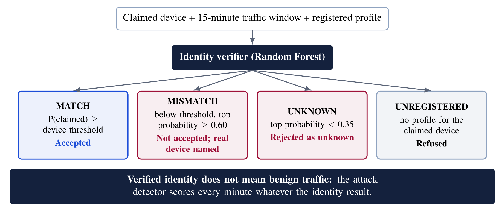
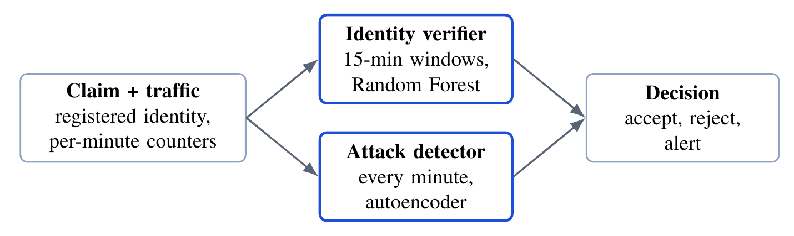
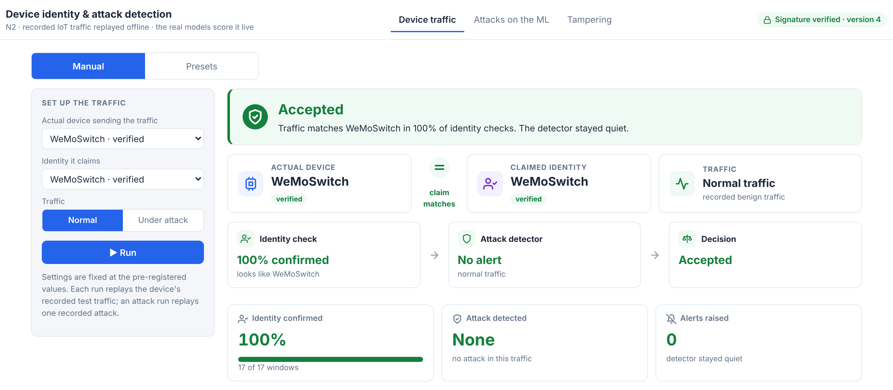
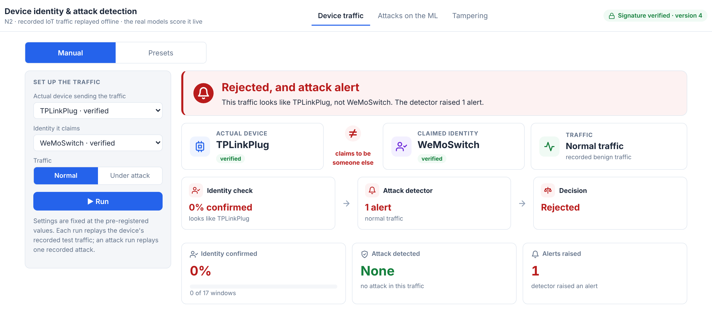
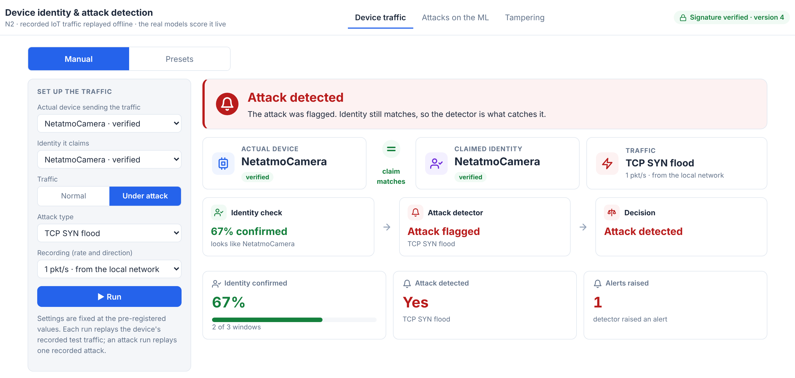
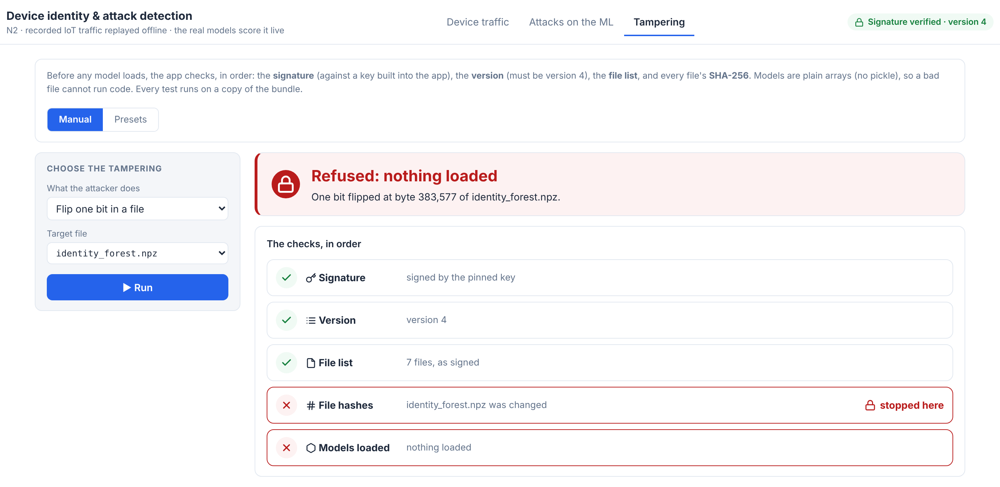

# Behavioural Identity Verification and Attack Detection for IoT Devices

A device on a home or office network says "I am the TP-Link plug". This project checks that claim from the device's network behaviour alone. It also watches every minute of traffic for attacks, and it tests whether the machine-learning models can themselves be attacked. Nothing is installed on the devices: everything is computed from per-minute flow counters seen at the router.

This was a course project for *Research in Information Security (CS8.501)*, IIIT Hyderabad. It was inspired by Pundir et al.'s MADP-IIME and evaluated on the UNSW IoT attack traces (10 devices, 8 attack types, 234 recorded attacks). The full write-up is in [Project_Report.pdf](Project_Report.pdf).



## Results

All numbers are from held-out test days, run once, after every threshold and success criterion had been fixed in advance ([RULES.md](RULES.md)).

| | Result |
|---|---|
| Attacks detected on the 4 verified devices | **42 / 42** (small sample: 7-13 attacks per device) |
| False alarms | 0.0-1.2% of normal minutes |
| Wrong identity claims accepted | **0.01%** |
| Unknown devices accepted | **0 of 730 windows** |
| Honest claims confirmed | 79.3% (target 80%: a partial pass) |
| Impersonation (black-box, up to 5,000 guesses) | 0 impostor windows accepted |
| Identity poisoning (up to 10% of training data) | No effect |
| Detector poisoning (10% of training data) | Detection fell to 89.2%; the defence did not recover it |
| Tampered or rolled-back model files | All refused before any model loaded |

| Verified device | Attacks detected | False-alarm minutes | Honest claims confirmed |
|---|---|---|---|
| WeMo switch | 12 / 12 | 0.7% | 96.5% |
| TP-Link plug | 13 / 13 | 1.1% | 78.2% |
| Netatmo camera | 10 / 10 | 0.0% | 100% |
| LIFX bulb | 7 / 7 | 1.2% | 85.9% |

## How it works



Two checks run side by side on the same traffic:

- **Identity verifier.** A Random Forest (500 trees) scores 15-minute windows. Each window has 120 features: the mean, standard deviation and maximum of 40 traffic counters. A claim is accepted when the probability of the claimed device is above that device's own threshold, with a vote over 3 windows.
- **Attack detector.** An autoencoder (80-64-16-64-80) is trained on normal traffic only. A minute whose reconstruction error is above the 99th percentile of validation errors raises an alarm. Two alarm minutes inside an attack count as a detection.

The models were chosen in two phases on development data:

1. **Phase 1, classical models:** Random Forest, XGBoost and an MLP for identity; Isolation Forest for detection. Identity worked from the start. Isolation Forest never reached a usable false-alarm rate.
2. **Phase 2, neural detectors:** an autoencoder and a temporal autoencoder that looks at 10 minutes at once. The plain autoencoder won, with 89.8% detection at 1.1% false alarms on development days. The temporal one was never better on any device.

The chosen system was then run once on held-out test days and held-out attacks. Finally, the models were attacked: impersonation, two kinds of training-data poisoning, and tampering with the model files.

## Repository

| Path | What it is |
|---|---|
| `Project_Report.pdf` | The full report: method, results and limitations |
| `RULES.md` | Every threshold and success criterion, fixed before the runs, plus the short names used in the code |
| `notebooks/` | The experiments, in the order they were run (table below) |
| `results/` | The summary result file written by each notebook |
| `demo/` | An offline web demo that runs the trained models on recorded traffic |
| `images/` | Figures used in this README |

| Notebook | What it does |
|---|---|
| `01_data_audit` | Checks the UNSW attack traces: devices, columns, attack annotations |
| `02_first_run` | First end-to-end run: Isolation Forest per device, identity models, per-device vs shared detector |
| `03_development_model_comparison` | Phase 1 and 2 on development data: Random Forest, XGBoost, MLP; Isolation Forest, autoencoder, temporal autoencoder |
| `04_development_threshold_fix` | Identity thresholds set from validation plus out-of-fold training windows |
| `05_development_tie_guard` | Alarm rule fixed for devices whose idle minutes all score the same |
| `06_confirmation_test_days` | The chosen system run once on held-out test days and attacks |
| `07_ml_security_impersonation_tamper` | Impersonation attack and model-file tampering |
| `08_ml_security_poisoning` | Identity poisoning and detector poisoning |
| `09_stability_over_time` | Re-fitting on growing windows of days to see whether thresholds drift |
| `10_export_demo_models` | Exports the models as plain arrays for the demo and checks they match |

## Run the demo

```bash
cd demo
pip install numpy cryptography
python server.py            # opens http://127.0.0.1:8765
```

At start-up the demo checks the Ed25519 signature of the model bundle, its version, its file list and every file hash. If any check fails, it loads no model. More detail is in [demo/README.md](demo/README.md).

| Honest claim accepted | Wrong claim rejected |
|---|---|
|  |  |
| **Genuine device under attack** | **Tampered model refused** |
|  |  |

## Re-running the experiments

```bash
pip install -r requirements.txt
```

The notebooks ran on Kaggle (CPU only) and read their data from `/kaggle/input/`. The UNSW IoT attack traces are not included here. They come from UNSW IoT Analytics: Hamza et al., *Detecting volumetric attacks on IoT devices via SDN-based monitoring of MUD activity*, ACM SOSR 2019. Attach them as a Kaggle dataset, or change that path to a local copy.

## Limitations

- Honest acceptance was 79.3%, just under the 80% target.
- Thresholds drift over time, so a deployment would need regular recalibration.
- Detector poisoning needs a better defence.
- Only 4 of 10 devices were verified; the rest get attack detection only.
- The impersonation attacker could only add traffic.
- The system was tested on recorded lab traffic from 2018, not on a live network.

## Team

Vishnu Vardhan, Anudeep Butha, Sandesh Nampally
